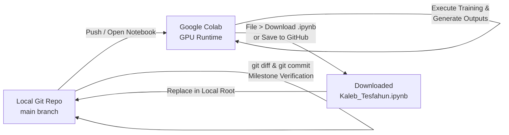

# Trustworthy Plant Disease Detection System

**Project:** iCog Labs — Computer Vision & Model Interpretability  
**Target:** 10-Class Tomato Leaf Disease Classification using the PlantVillage Dataset  
**Primary Deliverable:** `Kaleb_Tesfahun.ipynb` (Self-contained Jupyter Notebook)  
**Author:** Kaleb Tesfahun  

---

## 1. Project Objective

Agricultural diagnostics require deep learning systems that are not merely accurate on laboratory benchmarks, but also dependable, interpretable, and well-calibrated for real-world field deployment.

This project designs, trains, diagnoses, and refines a Convolutional Neural Network (CNN) in TensorFlow/Keras to classify tomato leaf conditions into 10 categories (9 diseases and 1 healthy state) using the tomato subset of the PlantVillage dataset.

Crucially, the system moves beyond raw classification accuracy by incorporating:
- **Visual Interpretability (Grad-CAM):** Auditing post-hoc spatial attribution and class-discriminative localization heatmaps to discover what visual features drive model predictions, diagnosing potential failure modes (such as background shortcut learning, inter-class symptom overlap, fine-grained lesion resolution loss, or illumination sensitivity).
- **Hypothesis-Driven Intervention:** Formulating targeted interventions based on empirical validation findings to eliminate diagnosed failure modes and retraining an improved model under identical evaluation constraints.
- **Confidence Calibration:** Assessing model trustworthiness via Expected Calibration Error (ECE) and reliability diagrams, fitting post-hoc calibration parameters (e.g., Temperature Scaling) on the validation set to prevent overconfident erroneous predictions in agricultural settings.
- **Production-Ready Inference Tool:** Delivering an end-to-end inference function combining classification, calibrated probabilities, and visual spatial attribution overlays.

---

## 2. Assignment Deliverables

The final submission strictly adheres to the single self-contained notebook requirement:

1. **`Kaleb_Tesfahun.ipynb`**:
   - Master end-to-end Jupyter Notebook containing all data acquisition, preprocessing, baseline model training, evaluation, Grad-CAM diagnostic pipeline, intervention logic, calibration assessment, and the final interactive inference utility.
   - Comprehensive technical report embedded in the concluding sections.
   - Experiment journal table detailing research hypotheses, interventions, before/after metrics, and architectural decisions.
2. **`README.md`**: Project architecture, development methodology, and synchronization workflows.
3. **`.gitignore`**: Security and cleanliness configurations ensuring no heavy data, model binaries, checkpoints, or secrets pollute source control.

---

## 3. Project Structure

```text
CNN_tomato_Grad-CAM/
├── .gitignore             # Ignores data, checkpoints, logs, caches, and secrets
├── README.md              # Project overview, methodology, and sync protocol
└── Kaleb_Tesfahun.ipynb   # Canonical, self-contained master notebook
```

*Note on modularity:* In accordance with assignment specifications, all helper functions, custom layers, data generators, and visualization routines are implemented cleanly within `Kaleb_Tesfahun.ipynb` rather than in an external `src/` directory, ensuring seamless standalone execution in Google Colab.

---

## 4. Execution Strategy: Local Source Control vs. Google Colab

### Environment Roles
- **Local Workstation (`/home/kaleb/dev/projects/iCog_Labs/CNN_tomato_Grad-CAM`)**:
  - The **canonical source of truth** and version control center.
  - Used for code authoring, Git repository tracking, milestone reviews, and offline inspection.
  - Hardware: Intel Core i7-1265U (10 cores / 12 threads, CPU-only, integrated Intel Iris Xe).
- **Google Colab**:
  - The **primary execution and compute runtime**.
  - Provides access to GPU hardware accelerators with CUDA support, enabling rapid CNN training iterations, batch gradient backpropagation for Grad-CAM, and fast network throughput for dataset ingestion.
  - The notebook code dynamically detects and adapts to whatever GPU or CPU hardware accelerator is provisioned.

### Runtime Synchronization Workflow

Google Colab provides an ephemeral runtime environment; disk contents are discarded when sessions disconnect. To maintain continuous version control locally without data loss, follow this synchronization protocol:



#### Step-by-Step Sync Protocol:
1. **Launch in Colab:**
   - Upload `Kaleb_Tesfahun.ipynb` to Google Colab, or open directly from the GitHub repository.
   - Verify GPU acceleration: `Runtime` &rarr; `Change runtime type` &rarr; select `Hardware accelerator: GPU`.
2. **Execute Current Milestone Cells:**
   - Run the designated milestone cells.
   - Ensure cell outputs, training progression graphs, and Grad-CAM visualizations render completely within the notebook.
3. **Retrieve Executed Notebook:**
   - In Colab, click `File` &rarr; `Download` &rarr; `Download .ipynb`.
   - Alternatively, if linked to a GitHub remote, use `File` &rarr; `Save a copy in GitHub`.
4. **Update Canonical Local Repository:**
   - Copy the downloaded `Kaleb_Tesfahun.ipynb` into the root directory of this repository (`/home/kaleb/dev/projects/iCog_Labs/CNN_tomato_Grad-CAM/`).
   - Run `git status` and `git diff` to review all newly added cell outputs and markdown updates.
   - Stage and commit with descriptive milestone messages following technical lead approval.

---

## 5. Artifact & Dataset Storage Conventions

To maintain a clean and lightweight Git repository:
- **Datasets:** The PlantVillage tomato subset is downloaded programmatically into an ephemeral runtime directory (e.g., `./data/plantvillage_tomato/` in Colab). It is never committed to Git.
- **Model Checkpoints:** Intermediate weights and final model files (`.keras` / `.h5`) are saved to `./models/` or temporary Colab storage. Only evaluation metrics, training curves, and lightweight visualizations are retained in the notebook.
- **Logs & TensorBoard:** Directed to `./logs/` and excluded by `.gitignore`.

---

## 6. Reproducibility Protocol & Split Isolation

All experiments adhere to strict reproducibility guidelines:
- **Unified Deterministic Seeding:** A unified random seed (`SEED = 42`) is initialized across Python's `random`, `numpy.random`, and `tf.random` via `tf.keras.utils.set_random_seed(SEED)`.
- **Limits of Hardware Determinism:** While fixed random seeds ensure reproducible dataset splits, initial weight tensors, and data augmentation sequences, exact bit-level numerical determinism is not guaranteed across different GPU hardware or CUDA driver versions due to non-deterministic parallel floating-point atomic reductions in cuDNN unless `tf.config.experimental.enable_op_determinism()` is explicitly enabled (which incurs runtime performance overhead).
- **Strict Split Isolation:**
  - **Training split (70% target):** Exclusively utilized for model parameter optimization.
  - **Validation split (15% target):** Utilized for hyperparameter tuning, validation error analysis, Grad-CAM failure diagnosis, hypothesis verification, and confidence calibration parameter fitting (e.g., Temperature Scaling).
  - **Test split (15% target):** Strictly untouched holdout partition reserved solely for final unbiased benchmark reporting.
- **Data Integrity & Leakage Prevention:** Planned 70%/15%/15% stratified splits will be verified, with duplicate and group-level leakage checks informed by Milestone 2 EDA findings.
- **Self-Contained Execution:** The notebook contains all imports, dependencies, data loading pipelines, and evaluation metrics so any researcher can reproduce the full experimental arc from cell 1 to the end.
